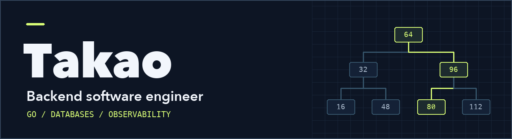

I'm a backend software engineer based in Japan. I primarily work with Go.

## Selected projects

| Project | What it explores |
| --- | --- |
| [Go RDBMS Playground](https://github.com/taako-502/go-rdbms-playground) | An embedded relational database in Go with a typed API, B-tree indexes, and a browser-based explorer. |
| [Database Index Write Benchmark](https://github.com/taako-502/db-index-write-benchmark) | Measures how secondary indexes affect insert and update performance in MongoDB and PostgreSQL. |
| [OpenTelemetry Playground](https://github.com/taako-502/otel-playground) | Generates requests, delays, and errors in a Go API, then traces and measures them with OpenTelemetry and Grafana. |
| [Next.js Cache Playground](https://github.com/taako-502/nextjs-cache-playground) | Uses production builds and browser interactions to show when Next.js reuses rendered output or fetched data. |

## Other projects

- [SlotPick](https://github.com/taako-502/slotpick) · A macOS app that turns calendar availability into meeting-time suggestions.
- [Custom Card Link](https://wordpress.org/plugins/custom-card-link/) · A WordPress plugin for link cards.
- [NAKITH](https://nakith.com/) · A market research app for NFT games.

[Blog](https://ap-ep.com/) · [Photography](https://www.threads.net/@_yamamoto_takao)
